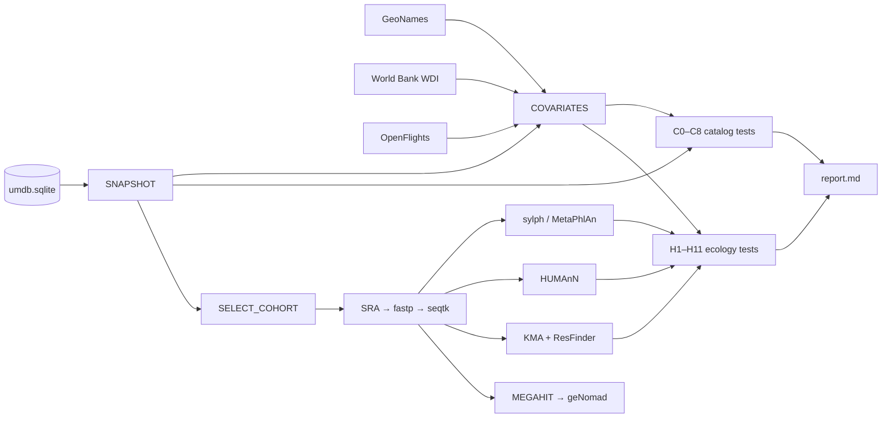

# UMDB-SCIENCE: a Nextflow pipeline for testing hypotheses on the Urban Microbiome Database

UMDB catalogs where urban microbiome sequencing has been done. This pipeline turns that catalog into evidence: it tests, reproducibly and against one frozen catalog state, whether urbanization acts as a global ecological and evolutionary filter producing predictable patterns of microbial composition, function, dispersal and persistence across cities.

It has three tracks:

| Track | Input | Runs on | Tests |
| --- | --- | --- | --- |
| **A · catalog** | `data/umdb.sqlite` | a laptop, minutes | C0–C8: coverage inequality, development, COVID-19, habitat bias, metadata completeness, centre concentration, technology diffusion, eligibility benchmark |
| **B · reads** | a balanced shotgun cohort chosen from the catalog | an HPC cluster, days | fetch → QC → depth standardization → species (sylph or MetaPhlAn 4), functions (HUMAnN → KO), resistance genes (KMA/ResFinder), viral contigs (MEGAHIT → geNomad) |
| **C · ecology** | the profiles from B, or matrices you supply | a workstation, minutes to hours | H1–H6, H9–H11: habitat vs geography, functional convergence, scaling laws, prediction in unsampled cities, mobility, cross-habitat connectivity, discovery, seasonality, resistome ecology |



## Quick start

```bash
# 1. Nextflow (>= 23.10) and conda/mamba or Docker
curl -s https://get.nextflow.io | bash        # or: conda install -c bioconda nextflow

# 2. Test on the synthetic fixture (planted effects; about 2 minutes)
nextflow run pipeline -profile test,conda

# 3. Catalog tests and the cohort feasibility audit on the real catalog
umdb catalog pull && umdb db build            # restores data/ and builds data/umdb.sqlite
nextflow run pipeline -profile conda --fetch_worldbank --openflights_dir ref/openflights

# 4. A pilot of the read track (200 runs), then the full cohort on a cluster
nextflow run pipeline -profile slurm,conda --run_reads --max_cohort_samples 200 \
    --sylph_db gtdb-r220-c200-dbv1.syldb --sylph_tax_dir sylph-tax/ --resfinder_db resfinder_db/
```

`umdb science …` runs the same thing from anywhere in the repository (it calls `nextflow run pipeline …`).

Results go to `--outdir` (default `results/`):

```text
results/
├── report.md                 every hypothesis: status, one-line result, caveats, files
├── report.json               the same, machine-readable, with the snapshot and cohort metadata
├── hypotheses_status.tsv
├── snapshot/                 samples.tsv.gz, runs.tsv.gz, snapshot.json (database SHA-256, rule versions)
├── covariates/               country, city and route tables; covariates_manifest.json (sources, dates, SHA-256)
├── cohort/                   cohort_samples.tsv, cohort_runs.tsv, feasibility.tsv/.json
├── hypotheses/<ID>/          summary.json, tables (.tsv) and a figure (.png) per test
├── profiles/                 species_matrix.tsv, humann_matrix.tsv, kma_matrix.tsv (Track B)
└── pipeline_info/            Nextflow timeline, report and trace
```

## The hypotheses

`assets/hypotheses.csv` is the registry: one row per hypothesis, with its track, script, required inputs and research programme. The pipeline runs every implemented test whose inputs are available and the report lists the rest with the reason. Each test states its **decision rule before it sees data** (in the script docstring) and reports `supported`, `not_supported`, `inconclusive` or `descriptive`. These are statements about the evidence in UMDB under that rule, not general truths; read the caveats in each summary.

### Track A · catalog (no sequence data needed)

| ID | Question | Method | Decision rule |
| --- | --- | --- | --- |
| C0 | How much of the catalog is usable for spatial and temporal inference? | Flags for missing places, impossible dates (future, after release, before 1950), conflicting coordinates, by tier, assay and continent | Descriptive; flags exclude samples downstream |
| C1 | Is coverage unequal relative to where people live? | Concentration index of urban samples vs population; Gini; continent representation ratios; cities ≥ 1 M with no sample within 50 km | Index ≥ 0.4 with bootstrap CI above 0.4 |
| C2 | Does surveillance capacity track economic development? | Negative-binomial regression of samples (and BioProjects) on log GDP per capita, urban share, offset log population; R&D sensitivity model | GDP elasticity > 0, p < 0.05, in both |
| C3 | Did COVID-19 structurally change urban sequencing? | Interrupted time series (segmented regression, month effects, Newey–West SEs) at 2020-03, by habitat; wastewater share before/after | Level or slope break p < 0.05 and composition shift p < 0.05 |
| C4 | Are habitats systematically under-represented? | Pielou evenness; habitat × continent χ² on BioProjects with adjusted residuals | Evenness < 0.6 and χ² p < 0.05 |
| C5 | Does metadata completeness vary by assay, region and time? | Logistic models with BioProject-clustered SEs for four completeness outcomes; joint Wald tests | Assay terms significant for every outcome |
| C6 | Do few centres produce most data? | Top-1%/top-10 shares, Gini, HHI over submitting centres; trend by year | Top 1% of centres hold > 50% of samples |
| C7 | Do technologies diffuse unevenly? | Adoption lag of long-read, NovaSeq and DNBSEQ per country after global introduction; lag vs GDP | Negative lag–GDP correlation, p < 0.05, for any technology |
| C8 | How accurate is the eligibility screen? | Stratified, blinded labeling sheet; with `--labels`, catalog-weighted precision, recall, F1 and κ | Descriptive (needs expert labels) |

### Track C · ecology (needs profiles)

| ID | Programme | Question | Method | Decision rule |
| --- | --- | --- | --- | --- |
| H1 | UMDB-ECO | Does habitat explain more community variation than the city? | db-RDA variance partitioning (habitat, city, study); PERMANOVA with restricted permutations; Δ similarity of same-habitat/different-city vs different-habitat/same-city pairs from **different studies**, city cluster bootstrap; distance decay | Δ > 0 (CI above 0) and unique habitat R² > unique city R² |
| H2 | UMDB-ECO | Do habitats converge in function despite taxonomic divergence? | Relative dispersion across cities for species vs KO profiles; cluster bootstrap; Mantel species vs function | R_species − R_function > 0 (CI above 0) |
| H3 | UMDB-SCALE | Does richness scale as D = D₀N^β? | Incidence-rarefied richness per (city, habitat) vs GeoNames population, OLS with habitat effects and city bootstrap; AIC against null and curved models; sample-level mixed model with study intercepts | β CI excludes 0 |
| H4 | UMDB-AI | Are communities predictable in unsampled cities? | Random forest on habitat, location, climate band, population, GDP, season; skill vs the mean community under random, leave-studies-out and **leave-cities-out** CV | Held-out-city skill > 0 in every fold |
| H5 | UMDB-ECO | Does air travel shape biogeography beyond distance and climate? | Partial Mantel of city-centroid dissimilarity vs OpenFlights route distance, controlling great-circle distance or climate | Partial r > 0, p < 0.05 |
| H6 | UMDB-ECO | Do a city's habitats share taxa non-randomly? | Effort-matched Jaccard between habitat pools per city vs label permutations; sign test and Kruskal–Wallis across habitat pairs | Both p < 0.05 |
| H9 | UMDB-ECO | Is diversity undiscovered, most of all in under-sampled regions? | Incidence rarefaction, Chao2, sample coverage, new species per sample; at equal effort, under- vs well-sampled continents | Completeness < 0.9 and higher undiscovered share where sampling is sparse |
| H10 | UMDB-ECO | Is turnover seasonal, following the local season? | Within-habitat PCoA, study × habitat fixed effects; AIC for none, calendar, hemisphere-aligned and aligned × climate harmonics | Aligned beats none and calendar by ΔAIC > 2 |
| H11 | UMDB-AMR | Do resistomes differ by habitat within cities and track taxonomy and development? | PERMANOVA within cities; Mantel resistome vs species; ARG load on habitat, GDP and sanitation with country-clustered SEs | Habitat PERMANOVA p < 0.05 |

### Roadmap (registered, not yet implemented)

| ID | Programme | What is needed |
| --- | --- | --- |
| H7 | UMDB-EVO | Convergent molecular evolution: MAG binning (MetaBAT2/SemiBin2), CheckM2, dRep species clusters, ortholog alignment and HyPhy selection scans (aBSREL/BUSTED/RELAX) contrasting urban habitats |
| H8 | UMDB-VIR | Viral persistence: vOTU clustering of the geNomad output (95% ANI, 85% AF), read mapping for occupancy, then dynamic occupancy and survival models with time-forward validation |
| H12 | UMDB-ECO | Urbanization-driven homogenization: a matched non-urban comparator cohort (the catalog's `non_urban` tier) and beta-dispersion tests |
| H13 | UMDB-ECO | Resilience: event-aligned time series (floods, heatwaves, lockdowns) |
| H14 | UMDB-ECO | Climate-driven redistribution: ERA5-linked range models over time |

Also planned: ERA5, WorldPop, GHSL (functional urban areas for H3), OpenAQ, OpenStreetMap land use, WHO/UNICEF JMP and MODIS covariates, each versioned in `covariates_manifest.json`; an amplicon (16S/ITS) branch with DADA2 for the 62,000+ marker-gene runs; and a pretrained "urban microbiome foundation model" to replace the H4 baseline.

## Design choices that matter for inference

* **One frozen catalog.** `SNAPSHOT` reads the database once and records its SHA-256 and rule versions; every test reads the snapshot. Re-running on the same database gives the same numbers (fixed seeds throughout).
* **BioSample is the unit.** Runs are aggregated to samples; habitats, places and tiers come from the eligibility screen and validated locations, never from raw submitter text.
* **Urban means confirmed or probable.** Every test uses only those tiers; C8 measures how good that label is.
* **Studies are not independent.** The direct tests in H1 and H2 use only pairs of samples from different BioProjects; H3 and H5 work at the city level; models cluster standard errors or add random effects by study or country; H4 holds out whole cities and whole studies.
* **Effort and depth are standardized.** Reads are capped (`fastq-dump -X`, then exactly `--subsample_reads` pairs), and samples below depth are dropped; richness comparisons use incidence rarefaction to equal numbers of samples.
* **The cohort is balanced, not maximal.** `SELECT_COHORT` splits the target evenly across habitats, draws round-robin across cities and caps each city-habitat cell and each BioProject (defaults 50 and 300). On the 2026-11-16 catalog, 16,083 urban shotgun samples are eligible and the caps allow 9,221 (774 cities, 63 countries, 919 BioProjects; 98 Tbp raw, 13.6 Tbp after capping at 5 M read pairs). The cohort is wastewater-heavy because the catalog is; transit has fewer than 200 eligible samples.
* **Decision rules first.** Each test's rule is written in its docstring and applied mechanically; changing a rule should be a reviewed commit, not a tweak after seeing results.

## Inputs and parameters

| Parameter | Default | Notes |
| --- | --- | --- |
| `--db` | `../data/umdb.sqlite` | Build with `umdb db build` |
| `--geonames_dir` | `../data/reference/geonames` | `countryInfo.txt`, `cities500.zip` (shipped in the catalog bundle) |
| `--fetch_worldbank` / `--worldbank` | off / none | Fetch WDI indicators at run time, or pin a pre-fetched TSV for an exact rerun (the fetched file is saved to `covariates/worldbank_wdi.tsv`) |
| `--openflights_dir` | none | `airports.dat`, `routes.dat` from openflights.org (ODbL); enables H5 |
| `--koppen_raster` | none | Köppen–Geiger GeoTIFF (Beck et al.); needs `rasterio`. Without it, a latitude-band proxy is used and labelled as such |
| `--hypotheses` | `all` | Comma list, e.g. `C1,C3,H1` |
| `--cohort_target`, `--cohort_max_per_cell`, `--cohort_max_per_project`, `--cohort_min_bases`, `--cohort_assays` | 15000, 50, 300, 1e9, `WGS` | Cohort selection |
| `--cohort` | none | Use a saved `cohort_runs.tsv` (freeze the cohort for a paper) |
| `--run_reads` | false | Track B |
| `--max_spots`, `--subsample_reads`, `--drop_below_depth` | 10 M, 5 M, true | Depth control |
| `--taxonomy_tool` | `sylph` | `sylph` (GTDB; needs `--sylph_db`, `--sylph_tax_dir`) or `metaphlan` (`--metaphlan_db`) |
| `--functional` | false | HUMAnN 3 (`--humann_nucleotide_db`, `--humann_protein_db`); expensive |
| `--amr` | true | KMA against ResFinder (`--resfinder_db`, KMA-indexed) |
| `--viral` | false | MEGAHIT + geNomad (`--genomad_db`); inputs for H8 |
| `--species`, `--functions`, `--arg` | none | Feature × BioSample TSVs, to run Track C without Track B |
| `--labels` | none | Completed C8 labeling sheet |
| `--permutations`, `--max_samples`, `--seed` | 999, 3000, 20261119 | Statistics |
| `--fail_fast` | false | By default a failing test is reported and the others continue |

`-resume` does not notice edits to scripts in `bin/` (Nextflow hashes the process command, not the scripts it calls). After changing a test, rerun without `-resume`, or delete that test's work directory.

Profiles: `conda`, `mamba`, `docker` and `singularity` (both build containers from the conda specs with Seqera Wave), `slurm`, `test`. Tool versions are pinned in `modules/local/reads.nf`; the analysis environment is `envs/analysis.yml`.

**Check before the first cluster run:** the sylph-tax and HUMAnN database layouts change between releases. Run a 20-sample pilot (`--max_cohort_samples 20`) and inspect `profiles/` before launching the full cohort.

## Adding a hypothesis

1. Write `bin/umdb_<id>_<name>.py`. Use `umdb_common.base_parser` (every test gets the same arguments) and finish with `write_summary(...)`, giving a status from the decision rule in your docstring.
2. Add a row to `assets/hypotheses.csv` (`requires` lists `species`, `functions`, `arg`, `routes` or `worldbank`, separated by `;`).
3. If it needs new data, plant the effect in `tests/make_fixture.py`, regenerate the fixture, and check that `-profile test` recovers it.
4. Run `python3 -m unittest discover pipeline/tests`.

## Testing

* `tests/make_fixture.py` builds a 255-sample synthetic catalog with planted effects (habitat > city > study; strong functional convergence; richness ∝ population; hemisphere-aligned seasonality; ARG load falling with GDP) and no mobility effect or unseen species, which act as negative controls. `-profile test` should report H1, H2, H3, H4, H6, H10 and H11 as supported, and H5 and H9 as not supported.
* `tests/test_stats.py` checks the statistical helpers (Gini, Chao2, rarefaction, PERMANOVA, cohort water-filling) against known values.
